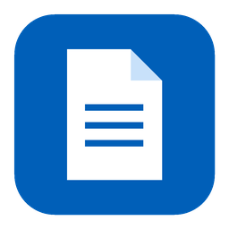

   
   <h2>Lectrix</h2>
   
Free, open-source PDF editor for Windows, macOS and Linux: lightweight, fast, and designed with care

 

<!-- Screenshot of the app goes here: one image, in a light and a dark version. -->

## Why Lectrix

- **Free, and private.** Open-source, with no paid version or paid features, no account and no data collected. Lectrix works offline and goes online only to check for a new version, which **Settings** can turn off.
- **The same app on Windows, macOS and Linux.** One interface and the same tools on all three systems; none of them is treated as second-class.
- **Lightweight and fast.** The Windows installer is under 9 MB. On a mid-range laptop the window is up in a tenth of a second, and the first page of a 1,000-page book is on screen within 0.6 seconds of launch.
- **Designed with care.** A modern, well thought-out interface that takes the pain out of the part of a PDF app you meet most: everyday use. Choose a light or a dark theme, dock the annotation toolbar or let it float at any edge of the pages, pick the quick tools offered for selected text, move the side panels between the two panes, and change any keyboard shortcut.
- **Careful with your files.** Saving never leaves a half-written file behind, and a copy of your unsaved changes, kept every two minutes, is offered back after a crash.

## Features

### Read comfortably

Open documents in tabs, and drag a tab away from the others to give it a window of its own. Pages scroll continuously or turn one at a time, alone or two side by side, and **View > Full screen** leaves them alone on the screen. **Visual adjustments** dims the pages or inverts their colours for reading at night, without touching the file.

### Make all kinds of annotations

Highlight, underline, strike out or squiggle text, leave a note, draw with the pen, or type in a text box. Select text and a small bar offers the tools you use most, with no need to pick one first. Every tool has 18 preset colours, a colour of your own and an opacity.

### Keep track of every comment

The annotation list shows every comment in a document. Search, sort and filter them by type, colour or author, and the pages show only what the list shows. Reply to a comment or edit it right in the list.

### Organise a document with bookmarks

Press **Ctrl+B** to add a bookmark where you are; selected text becomes its title. Rename bookmarks, drag them into order, nest them, and point one at another place.

### Number pages as the book does

Give the front matter roman numerals, start the body at 1, add a prefix to the appendices. The page box then understands the book's own numbers: type `iv` to go to page iv.

### Combine files

Add several PDFs, see all their pages together in one grid, then reorder, rotate or remove pages before combining them into a new file. Bookmarks and page numbering come along, and **Insert pages from file** brings another file's pages into the document you have open.

### Annotations that work everywhere

What you write in Lectrix opens as you made it in Acrobat, in Edge, Chrome and Firefox, and in Foxit. **Document > Repair annotations** fixes annotations made in other apps that show wrongly, or not at all, elsewhere.

## How Lectrix compares

### Tools

| | Lectrix | Acrobat Pro | FineReader PDF | Foxit PDF Editor | PDF-XChange Editor | Okular | SumatraPDF⁶ |
| --- | :---: | :---: | :---: | :---: | :---: | :---: | :---: |
| **The app** | | | | | | | |
| Price | Free | $19.99 a month¹ | $99 a year² | From $10.99 a month, or $209.99 once | Free³, or $62 once | Free | Free |
| Open source | ✅ | ❌ | ❌ | ❌ | ❌ | ✅ | ✅ |
| Windows | ✅ | ✅ | ✅ | ✅ | ✅ | ✅ | ✅ |
| macOS | ✅ | ✅ | Fewer tools² | ✅ | ❌ | Test builds only⁴ | ❌ |
| Linux | ✅ | ❌ | ❌ | ❌ | ❌ | ✅ | ❌ |
| Windows download | 8.7 MB | 1.7 GB | Not published⁵ | Not published⁵ | 402 MB | 164 MB⁴ | 11 MB |
| **What Lectrix does** | | | | | | | |
| Annotations | ✅ | ✅ | ✅ | ✅ | ✅ | ✅ | ✅ |
| Edit bookmarks | ✅ | ✅ | ✅ | ✅ | ✅ | ❌ | ❌ |
| Page labels | ✅ | ✅ | ❌ | ✅ | ✅ | ❌ | ❌ |
| Combine files | ✅ | ✅ | ✅ | ✅ | ✅ | ❌ | ❌ |
| Organise pages | ✅ | ✅ | ✅ | ✅ | ✅ | ❌ | ❌ |
| Compress | ✅ | ✅ | ✅ | ✅ | ✅ | ❌ | ❌ |
| Compare documents | ✅ | ✅ | Corporate² | ✅ | Plus³ | ❌ | ❌ |
| Add and remove passwords | ✅ | ✅ | ✅ | ✅ | ✅ | ❌ | ❌ |
| **What Lectrix doesn't do yet** | | | | | | | |
| Recognise text in scans (OCR) | Planned | ✅ | ✅ | ✅ | ✅ | ❌ | ❌ |
| Fill forms | Planned | ✅ | ✅ | ✅ | ✅ | ✅ | ❌ |
| Digital signatures | Planned | ✅ | ✅ | ✅ | ✅ | ✅ | ❌ |
| Edit the text on a page | Planned | ✅ | ✅ | ✅ | ✅ | ❌ | ❌ |
| Redaction | Planned | ✅ | ✅ | ✅ | ✅ | ❌ | ❌ |
| Convert to Word and Excel | ❌ | ✅ | ✅ | ✅ | ✅ | ❌ | ❌ |

1. On a yearly plan. Acrobat Reader is free: it reads, annotates, fills forms and signs.
2. Standard edition for Windows. The Corporate edition, which adds Compare, is $165 a year. The macOS version is $69 a year and has fewer PDF tools.
3. The free version puts a watermark on files changed with paid tools. Compare needs Editor Plus, $79 once.
4. KDE's own Windows build; KDE recommends the Microsoft Store version. On macOS there are only untested nightly builds.
5. They ask for 1.6 GB (FineReader) and 7.5 GB (Foxit) of free disk space.
6. Version 3.6.1. Version 3.7, in pre-release, adds combining and organising pages, compression, passwords, form filling, digital signatures and redaction.

### Everyday use

Much of the work on Lectrix goes into how its tools feel, not only into what they do.

| | Lectrix | Acrobat Pro | FineReader PDF | Foxit PDF Editor | PDF-XChange Editor | Okular | SumatraPDF |
| --- | :---: | :---: | :---: | :---: | :---: | :---: | :---: |
| First page of a 1,000-page book on screen⁷ | 0.6 s | 0.9 s | 1.2 s | Not tested¹⁰ | 1.1 s | 1.8 s | 0.4 s |
| Tools over selected text, of your choice | ✅ | A fixed set | ❌ | A fixed set | ❌ | ❌ | ❌ |
| Annotation toolbar at any edge of the window | ✅ | ❌ | ❌ | ❌ | Classic interface⁹ | ✅ | ❌ |
| Change any keyboard shortcut | ✅ | ❌ | OCR Editor only⁸ | ✅ | ✅ | ✅ | ✅ |
| Dark pages for reading at night | ✅ | ✅ | ❌ | ✅ | ✅ | ✅ | ✅ |
| Brightness, contrast and sepia | ✅ | ❌ | ❌ | ❌ | ❌ | ❌ | ❌ |
| Documents side by side in one window | Up to four, scrolling and zooming together | One document split in two | ❌ | Not documented¹⁰ | ✅ | ❌ | ❌ |
| Presenter view on a second screen | ✅ | ❌ | ❌ | ❌ | ❌ | ❌ | ❌ |
| No ads, upgrade prompts or sign-in | ✅ | ❌ | ✅ | ❌ | ❌ | ✅ | ✅ |

7. From launch until the page is on screen, measured the same way for every app on one laptop: the median of three runs after a first one.
8. FineReader's PDF editor has fixed shortcuts; only its OCR Editor lets you change them.
9. In PDF-XChange's classic interface, toolbars can be docked at any edge; its default ribbon stays at the top.
10. Foxit was not installed for these tests, and its manual doesn't say.

Tested with Acrobat Pro 24.1, FineReader PDF 16, PDF-XChange Editor 11.1, Okular 26.08 and SumatraPDF 3.6.1 on Windows 11.

Checked in October 2026 against each maker's website; prices are in US dollars, for one user. Found something out of date? Please [open an issue](https://github.com/pan4ratte/lectrix/issues).

## Download and install

Get the latest version from the [releases page](https://github.com/pan4ratte/lectrix/releases/latest), and pick the file for your system:

| System | File | Requires |
| --- | --- | --- |
| Windows | `Lectrix_…_x64-setup.exe` | Windows 10, version 1809 or later, or Windows 11; 64-bit |
| macOS, Apple Silicon | `Lectrix_…_aarch64.dmg` | macOS 26 |
| macOS, Intel | `Lectrix_…_x64.dmg` | macOS 15 or later |
| Debian, Ubuntu and their relatives | `Lectrix_…_amd64.deb` | Debian 13, Ubuntu 24.04, or later |
| Fedora and its relatives | `Lectrix-….x86_64.rpm` | Fedora 40 or later |
| Any other Linux | `Lectrix_…_amd64.AppImage` | glibc 2.39 or later; 64-bit |

The builds are not signed with a Microsoft or Apple certificate yet, so the first install asks for one more step:

* **Windows:** if SmartScreen says "Windows protected your PC", choose **More info**, then **Run anyway**.
* **macOS:** the first launch is blocked. Allow it in **System Settings > Privacy & Security** with **Open Anyway**.

After that Lectrix updates itself: it tells you when a new version is out and shows what it brings before you install it. [CHANGELOG.md](CHANGELOG.md) lists the changes in every version.

Lectrix is developed on Windows first. The macOS and Linux builds are newer and less tested. On macOS, the versions above are the ones each build is made on: the Apple Silicon build has its automatic tests run there, the Intel build has none yet, and older versions of macOS are untried.

## Contributing

Found a bug, or something that looks wrong on your system? Please [open an issue](https://github.com/pan4ratte/lectrix/issues), and attach the PDF that shows the problem if you can share it.

Pull requests are welcome too. [CONTRIBUTING.md](CONTRIBUTING.md) explains how to build Lectrix, run its tests and find your way around the code.

## About the author

My name is Mark Ingrem. I build various tools for scientific research, and add-ons that make life easier for people using Obsidian and other programs. More of my projects can be found on my [GitHub](https://github.com/pan4ratte) page.

If Lectrix is useful to you, you can [support its development](https://pay.cloudtips.ru/p/c0e8eac4). The page takes cards issued in Russia.

## Licence and third-party software

Lectrix is free software under the [GNU AGPL v3](LICENSE) or any later version. Its app icon and PDF file icon are not covered by that licence: they are © Mark Ingrem, all rights reserved.

* [MuPDF](https://mupdf.com) PDF engine — AGPL-3.0
* [Tauri](https://tauri.app) app shell — MIT or Apache-2.0
* [Svelte](https://svelte.dev), [Tailwind CSS](https://tailwindcss.com) and [Bits UI](https://bits-ui.com) — MIT
* [Lucide](https://lucide.dev) icons — ISC
* [Google Sans](https://github.com/googlefonts/googlesans) font — SIL OFL 1.1
* Colours adapted from [Neo](https://github.com/x0aa7i/obsidian-neo), a theme for Obsidian — MIT

The full list is in [THIRD_PARTY_NOTICES.md](THIRD_PARTY_NOTICES.md).
